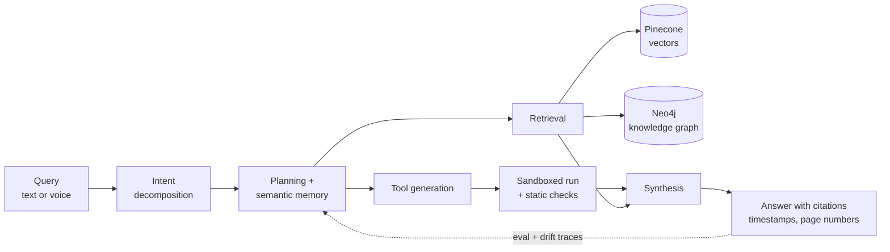

<h1 align="center">Adelard Dcunha</h1>

  <b>AI/ML Engineer</b> &nbsp;·&nbsp; Generative AI &nbsp;·&nbsp; Agentic Systems &nbsp;·&nbsp; RAG

  <i>Generative and agentic AI that runs in production — including the part nobody demos.</i>

  
  
  
  
  
  

---

## About

**Software Development Engineer at EduvanceAI**, building generative and agentic AI for production. Day to day that means multi-agent systems that let consultants query their own datasets in plain English, RAG pipelines over documents and video, and the chat and voice layers sitting on top of them.

A good share of the work is the part nobody demos: sandboxing the code agents write, keeping every answer traceable back to a source page or timestamp, and watching models for drift after they ship.

My projects lean toward systems where being wrong is expensive — real-time card fraud scoring, hierarchical demand forecasting, autonomous voice intake. A diploma in electronics before the engineering degree is probably why I ended up writing the audio DSP library instead of just calling the ASR API.

**Open to:** AI/ML Engineering · Agentic & GenAI Systems · Applied ML in BFSI.

---

## How I Build

Three things I keep coming back to:

- **Traceable or it didn't ship.** Every answer carries a timestamp or a page number, so a user can check the source instead of trusting the model.
- **Agent-written code runs in a sandbox.** Static checks and isolation, not optimism.
- **Pick the operating point from cost, not F1.** Thresholds should reflect what a mistake actually costs — chargebacks weigh differently from false declines.

---

## At EduvanceAI

- **Multi-agent analytics platform** — plain-English querying over client datasets, with a data-dictionary layer for schema context and memory that pulls relevant history mid-conversation. Handles feature engineering, EDA, analysis, and voice input. **Used by 100+ people across 4 enterprise clients.**
- **Runtime tool generation** — agents write Python tools on the fly and run them sandboxed. Decomposing each query into a list of intents took output consistency on repeated questions **from 62% to 100%**. Also built the Next.js chat frontend.
- **RAG over 1,000+ hours of video and 1,200 documents** — Neo4j for the knowledge graph, Pinecone for vectors. Video answers return timestamps, document answers return page numbers, so a field technician can verify rather than trust.
- **Audio-processing library** for the voice assistant — VAD, silence trimming, noise cancellation, clipping repair, click and pop removal, GPU acceleration. **Throughput +40%, cost per minute −60%**, plus the WER-vs-latency numbers behind our streaming setup.
- **Embedding spend from $512/month to ~$80** — benchmarked the OpenAI API against a self-hosted quantized multilingual model on EC2 G4 using WER and recall@k, then moved Hindi, English, and Hinglish retrieval across.
- **Sales Copilot** — forecasting, dealer clustering, and TSP route optimization producing monthly journey plans for 70 outlets across South and East India. **Travel distance −70%, visit coverage +50%.**
- **Error-logging and model-monitoring microservice** — downtime from near-constant to about once a week, and root cause roughly twice as fast.

---

## Projects

<!-- Swap the # links for real repo URLs, then pin these three on your profile. -->

### [Real-time fraud and anomaly detection for card transactions](#) &nbsp;BFSI
`Gradient Boosting` `Autoencoder` `PySpark Streaming` `Redis` `MLflow`

A flagged transaction has to be stopped before authorization completes, so every event is scored inline — **p99 under 40ms** against a Redis online feature store. Two models rather than one: gradient boosting for fraud patterns already seen, autoencoder reconstruction error for the ones that aren't, against a **0.2% positive class**. Thresholds come from expected-cost curves weighing chargeback losses against customers lost to false declines; optimizing F1 would have picked the wrong operating point. Features are built in PySpark Structured Streaming with point-in-time correctness — an earlier offline version leaked labels worth **11 AUC points**. PSI and KS monitors trigger retraining, MLflow gates promotion on precision@k, and new models roll out shadow then canary, with a SHAP explanation on every alert.

### [Autonomous voice intake and triage agent](#)
`STT` `Intent Classification` `LLM` `VoIP`

An agent that answers the phone for appliance repair businesses and runs the whole intake: takes the complaint, works out what's wrong, resolves or escalates, and books the visit. Speech-to-text and intent classification run on the live transcript, separating problems a caller can fix themselves from ones needing a technician on site. Minor cases get likely causes, a DIY fix, or a replacement part from an LLM layer; anything complicated becomes a scheduled visit. Appointments are booked straight from the transcript and synced to the dispatch calendar with nobody in the loop. Calls that used to ring out after hours now get a response.

### [Hierarchical demand forecasting for multi-store retail](#)
`MinT Reconciliation` `Conformal Prediction` `Keras` `SageMaker`

A retailer that replenishes per store but budgets per region needs forecasts that agree with each other. MinT reconciliation makes store-level predictions sum exactly to regional and national totals, removing the manual overrides planners had been using to paper over the mismatch. Several thousand intermittent series, rolling-origin backtested against seasonal-naive and gradient-boosted baselines before trusting the Keras model over either. Conformal prediction supplies calibrated intervals, so safety stock comes from measured uncertainty instead of a fixed buffer. Weekly SageMaker retraining with champion-challenger promotion gated on a statistically significant pinball-loss improvement, falling back to the statistical baseline when neural forecasts degrade.

---

## Stack

| | |
|---|---|
| **Agentic AI** | Multi-agent systems · Planning & intent decomposition · Semantic memory · Tool use & generation · Sandboxed execution · Guardrails · LangGraph |
| **GenAI & LLMs** | RAG · Prompt engineering & evaluation · Fine-tuning · Document understanding · Conversational AI · Quantization · Inference & cost optimization |
| **Retrieval & Storage** | Pinecone · ChromaDB · Neo4j knowledge graphs · Redis · PostgreSQL · Multimodal retrieval · recall@k evaluation |
| **ML, DL & NLP** | Classification · Regression · Clustering · Anomaly detection · Time-series forecasting · Speech-to-text · Feature engineering · Model evaluation |
| **Languages & Frameworks** | Python · SQL · TensorFlow · Keras · scikit-learn · Hugging Face Transformers · pandas · NumPy · SHAP · Node.js |
| **Data & Infra** | PySpark Structured Streaming · Apache Kafka · Docker · Kubernetes · AWS (EC2, SageMaker) · REST APIs & microservices |
| **MLOps** | MLflow · Drift detection (PSI, KS) · Automated retraining · Champion-challenger promotion · Shadow & canary rollout · Model monitoring |

---

## Writing

**[Your ASR Model Isn't the Problem, Your Signal Path Is](https://medium.com/@adelarddcunha07)** — why transcription accuracy is usually lost before the audio ever reaches the model.

---

## Background

**BE, Artificial Intelligence and Data Science** — Fr. Conceicao Rodrigues College of Engineering, Mumbai · 2021–2024
**Diploma, Electronics and Telecommunication** — St. Xavier's Technical Institute, Mumbai · 2018–2021

Certified in Mathematics for Machine Learning and Data Science, and the Machine Learning Specialization — DeepLearning.AI / Stanford on Coursera.

---

## Activity

  
  

---

  
    Off the clock: <a href="https://open.spotify.com/user/31wc6kr3n7x5wjkh3lk2yh6olsmm?si=64112b1b52444c1d">something loud on Spotify</a>
    &nbsp;·&nbsp;
    <a href="https://discord.gg/preanYQNJ9">arguing about architecture on Discord</a>
  

  

