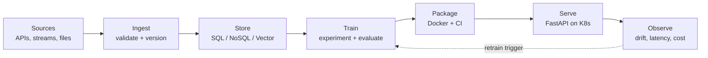

<h1 align="center">Adlard Dcunha</h1>

  <b>AI/ML Engineer</b> &nbsp;·&nbsp; <b>Solution Architect</b> &nbsp;·&nbsp; <b>Data Scientist</b>

  <i>I build the unglamorous 90% that makes the model in the notebook survive production.</i>

  
  
  
  
  

---

## About

I'm an engineer who likes the parts of ML that don't fit inside a notebook — data that arrives broken, models that quietly drift, and all the infrastructure in between. Most of my work lives at the seam between **research and production systems**: pipelines, serving, evaluation, and the observability that tells you when something stopped working three days ago.

Right now I'm going deep on **AI/ML for quantitative finance** — numerical methods, signal research, and backtesting infrastructure. Off-hours I fall down the **embedded systems and electronics** rabbit hole, which keeps me honest about latency, memory, and cost.

**Open to:** AI/ML Engineering · Solution Architecture · Quantitative Developer roles.

---

## How I Build

Three principles I keep coming back to:

- **Boring infrastructure, interesting models.** Novelty belongs in the model, not the deploy script.
- **Measure the seams.** Most production failures are integration failures, not model failures.
- **Cost is a design constraint.** A model nobody can afford to run isn't shipped.

---

## Selected Work

<!--
Replace these rows with 3–4 of your strongest repos, then pin the same ones on your profile.
Lead each description with the OUTCOME, not the tech. Compare:
  BAD  — "Built a RAG pipeline with LangChain and ChromaDB."
  GOOD — "Cut document lookup time from ~4 min to under 10s across 12k internal PDFs."
-->

| Project | What it does | Stack |
|---|---|---|
| **[project-name](#)** | _One line on the problem and the measurable result._ | `PyTorch` `FastAPI` `Docker` |
| **[project-name](#)** | _One line on the problem and the measurable result._ | `LangChain` `ChromaDB` `AWS` |
| **[project-name](#)** | _One line on the problem and the measurable result._ | `PySpark` `Airflow` `Redshift` |

---

## Stack

| | |
|---|---|
| **Languages** | Python · SQL · Node.js |
| **ML & DL** | PyTorch · TensorFlow · scikit-learn · OpenCV · pandas · NumPy |
| **LLMs & GenAI** | Transformers · HuggingFace · LangChain · AWS Bedrock · ChromaDB |
| **Backend & APIs** | FastAPI · Flask · Django |
| **Data Engineering** | PySpark · Redshift · DuckDB · Neo4j |
| **Databases** | PostgreSQL · MySQL · MongoDB · Cassandra · DynamoDB |
| **Cloud & DevOps** | AWS · GCP · Docker · Kubernetes · NGINX · Git |
| **Frontend** | React · React Native · TailwindCSS |

---

## Activity

  
  

---

  
    Off the clock: <a href="https://open.spotify.com/user/31wc6kr3n7x5wjkh3lk2yh6olsmm?si=64112b1b52444c1d">something loud on Spotify</a>
    &nbsp;·&nbsp;
    <a href="https://discord.gg/preanYQNJ9">arguing about architecture on Discord</a>
  

  

