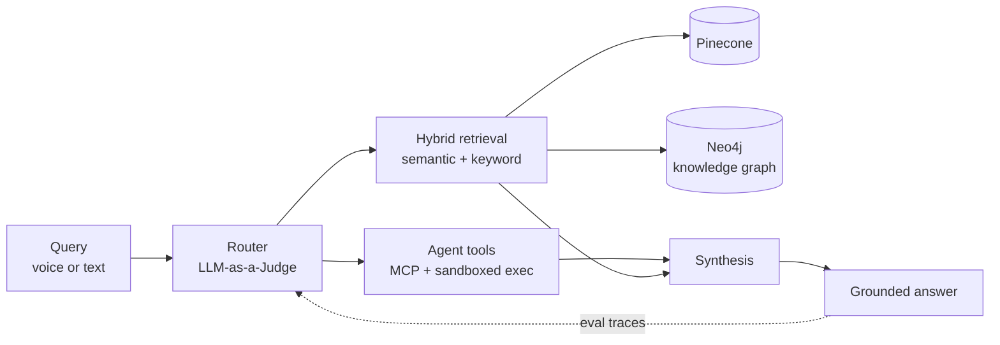

<h1 align="center">Adelard Dcunha</h1>

  <b>AI/ML Engineer</b> &nbsp;·&nbsp; <b>Data Scientist</b> &nbsp;·&nbsp; <b>Solution Architect</b>

  <i>I build agentic AI and RAG systems — plus the unglamorous 90% that keeps them running after the demo.</i>

  
  
  
  
  

---

## About

**Senior Software Development Engineer at EduvanceAI** (Vanmat Technologies), where I've gone from Junior System Engineer to Senior SDE in under a year. I work on generative AI, RAG, and agentic systems that ship to real users — natural-language analytics over structured data, multilingual voice assistants, and retrieval pipelines built on knowledge graphs and vector stores.

Most of my time goes to the parts of ML that don't fit in a notebook: routing accuracy, retrieval quality, inference cost, drift, and the monitoring that tells you when something quietly stopped working three days ago.

Longer-term I'm pulled toward **quantitative finance** — credit risk modelling, survival analysis, and the numerical side of things. A diploma in electronics before my engineering degree is probably why I still care about latency, memory, and cost as first-class design constraints.

**Open to:** AI/ML Engineering · GenAI & Agentic Systems · Quantitative Developer roles.

---

## Shipped Recently

- **Agentic analytics platform** — natural-language querying over structured datasets via a custom data dictionary, with specialized agents for feature engineering, EDA, and visualization. Includes a concurrent tool generator/executor running inside a secure Python sandbox.
- **Self-hosted multilingual embeddings** on AWS EC2 G4 for Hindi/English retrieval — **~70% lower API costs** after benchmarking and quantization.
- **Concurrent video + document RAG** (Neo4j + Pinecone) with timestamp-aware video retrieval and page-level document recommendations for field technicians.
- **Model monitoring microservice** with real-time error logging — **~40% less AI application downtime**.
- **Sales copilot** combining time-series analysis, clustering, recommendation engines, and TSP route optimization for monthly dealer journey plans across Southern and Eastern India.

---

## How I Build

Three things I keep coming back to:

- **Boring infrastructure, interesting models.** Novelty belongs in the model, not the deploy script.
- **Measure the seams.** Most production failures are routing and integration failures, not model failures.
- **Cost is a design constraint.** A model nobody can afford to run isn't shipped.

---

## Selected Projects

<!-- Swap the # links for real repo URLs, then pin these two on your profile. -->

### [Conversational Enterprise Knowledge System](#)
`STT/TTS` `Agentic` `RAG` `MCP`

Full-stack voice assistant combining speech-to-text, agentic tool execution, and retrieval. Real-time voice processing handles voice activity detection, noise reduction, silence trimming, and interruption. An MCP-based tool ecosystem wires in Calendar, Google Meet, Drive, Weather, and Maps, with a hybrid semantic + keyword retrieval pipeline and LLM-as-a-Judge evaluation for tool routing.

### [Credit Risk Modeling & Scoring System](#)
`XGBoost` `LightGBM` `Survival Analysis` `SHAP`

End-to-end pipeline estimating PD, LGD, and EAD on Lending Club and simulated data. 50+ engineered features across financial ratios, behavioral signals, credit history, and macro indicators, with SMOTE and stratified CV for class imbalance. **0.89 AUC-ROC** on PD classification and an **18% improvement in Expected Loss estimation** over baseline. Automated retraining fires on data drift detected via the Kolmogorov–Smirnov test.

---

## Stack

| | |
|---|---|
| **Languages** | Python · SQL · Node.js |
| **GenAI & LLMs** | RAG · Agentic workflows · LangGraph · Hugging Face Transformers · MCP · Fine-tuning · Quantization · KV caching · LLM-as-a-Judge |
| **ML & Statistics** | Supervised / unsupervised · Reinforcement learning · Time-series forecasting · Feature engineering · Probabilistic modeling · Hypothesis testing · SHAP |
| **MLOps** | MLflow · Docker · Kubernetes · Model monitoring · Data-drift detection |
| **Data & Infra** | Apache Kafka · PySpark · Redis · AWS EC2 · AWS SageMaker |
| **Stores** | PostgreSQL (pgvector) · Pinecone · Neo4j knowledge graphs |
| **Frontend** | Next.js · React |
| **Domains** | EdTech analytics · Sales & dealer analytics · Credit risk |

---

## Background

**BE, Artificial Intelligence & Data Science** — Fr. Conceicao Rodrigues College of Engineering, Mumbai
**Diploma, Electronics & Telecommunication** — St. Xavier's Technical Institute, Mumbai

Certified in MLOps (Google Cloud) · Financial Engineering & Risk Management (Columbia) · Mathematics for ML and Data Science, and Machine Learning (DeepLearning.AI / Stanford)

---

## Activity

  
  

---

  
    Off the clock: <a href="https://open.spotify.com/user/31wc6kr3n7x5wjkh3lk2yh6olsmm?si=64112b1b52444c1d">something loud on Spotify</a>
    &nbsp;·&nbsp;
    <a href="https://discord.gg/preanYQNJ9">arguing about architecture on Discord</a>
  

  

